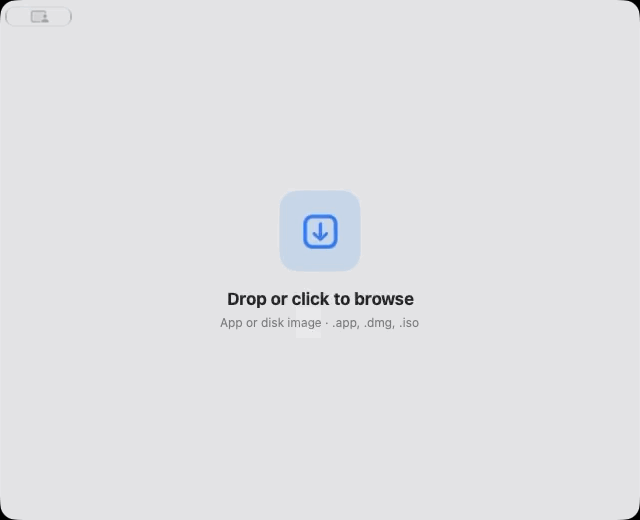

<div align="center">
  
  <h1>Unquarantine</h1>
  <p>A quiet, deliberate way to prepare a downloaded Mac app.</p>
  <p><strong>Universal for Apple silicon and Intel</strong> · SwiftUI · macOS 26+ · MIT</p>
</div>

<p align="center">
  
</p>

Unquarantine lets you review an app before removing its macOS quarantine flag.
It works with `.app` bundles and disk images, and asks for administrator
approval only when a copy into `/Applications` needs it.

## Download

Choose the installer for your Mac from the [0.1.0 release](https://github.com/ChloeVPin/Unquarantine/releases/tag/v0.1.0):

- **Apple silicon:** macOS 26 or later
- **Intel:** macOS 26

Open the disk image and drag Unquarantine into Applications. These release
builds are ad-hoc signed and not notarized, so macOS may ask you to confirm the
first launch. In Finder, Control-click the app and choose **Open** to confirm.

> Removing quarantine is an explicit exception, not a safety check. Unquarantine
> does not scan apps or verify their developers.

## Use it

1. Drop one app, `.dmg`, or `.iso` into the window, or choose it from the file picker.
2. Review the app and its trust prompt.
3. Choose **Trust & Prepare** only if you trust its source. If the app is not
   quarantined, Unquarantine explains that before continuing.
4. Open the prepared app or choose **Done**.

Disk images are mounted read-only. Unquarantine looks for one app inside and
ejects the image when the flow ends. It never replaces an app already in
`/Applications` with the same name.

## Build from source

You’ll need Xcode with the macOS 27 SDK. The build produces a universal app for
Apple silicon and Intel. Apple silicon Macs can run it on macOS 26 or later;
Intel Macs can run it on macOS 26, the latest Intel-compatible release.

```sh
./scripts/build-app.sh
```

The app bundle is written to `dist/Unquarantine.app`. Local builds are
ad-hoc signed and are not notarized.

## Background monitoring

The optional **Look for new quarantined apps** setting installs a user-scoped
LaunchAgent. It watches `/Applications` for newly added quarantined apps and
opens Unquarantine when it finds one. For relaunch while the app is closed,
keep Unquarantine installed in `/Applications`. Turn the setting off to remove
the agent.

## Updates

Unquarantine checks the latest public GitHub release once a day while it is
open. It never downloads or installs an update without your choice. When a
newer version is available, a compact pill appears at the top right of the main
window; choose **Update** to install and relaunch. Settings also has a manual
check and install control. The updater downloads the installer for your Mac,
checks its size and SHA-256 digest from GitHub Releases, then verifies the app
bundle before replacing the current copy. macOS asks for administrator approval
only when the app’s location requires it. You can turn automatic checks off in
Settings.

Updates use the same ad-hoc signed, non-notarized builds as the initial release.
GitHub’s release asset digest detects download corruption; it is not a separate
developer signature.

## Project notes

- [Usage and settings](docs/USAGE.md)
- [Privacy](docs/PRIVACY.md)
- [Security](SECURITY.md)
- [Architecture](docs/ARCHITECTURE.md)
- [Contributing](CONTRIBUTING.md)
- [Community standards](CODE_OF_CONDUCT.md)
- [Support](SUPPORT.md)
- [Changelog](CHANGELOG.md)
- [MIT license](LICENSE)

Unquarantine is an independent project and is not affiliated with Apple.

If you find it useful, [you can buy the developer a coffee](https://www.buymeacoffee.com/chloevalesquez).
