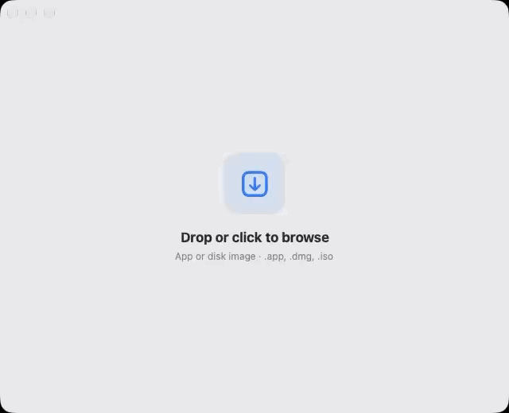

<div align="center">
  
  <h1>Unquarantine</h1>
  <p>A quiet, deliberate way to prepare a downloaded Mac app.</p>
  <p><strong>macOS 27 or later</strong> · SwiftUI · MIT</p>
</div>

<p align="center">
  <a href="docs/media/dropzone.mp4">
    
  </a>
</p>

<p align="center"><a href="docs/media/dropzone.mp4">Watch the short video</a></p>

Unquarantine lets you review an app before removing its macOS quarantine flag.
It works with `.app` bundles and disk images, and asks for administrator
approval only when a copy into `/Applications` needs it.

> Removing quarantine is an explicit exception, not a safety check. Unquarantine
> does not scan apps or verify their developers.

## Use it

1. Drop one app, `.dmg`, or `.iso` into the window, or choose it from the file picker.
2. Review the app and its trust prompt.
3. Choose **Trust & Prepare** only if you trust its source. If the app is not
   quarantined, Unquarantine explains that before continuing.
4. Open the prepared app or choose **Done**.

Disk images are mounted read-only. Unquarantine looks for one app inside and
ejects the image when the flow ends. It never replaces an app already in
`/Applications` with the same name.

## Build from source

You’ll need a Mac with Xcode and the macOS 27 SDK.

```sh
./scripts/build-app.sh
```

The app bundle is written to `dist/Unquarantine.app`. Local builds are
ad-hoc signed and are not notarized.

## Background monitoring

The optional **Look for new quarantined apps** setting installs a user-scoped
LaunchAgent. It watches `/Applications` for newly added quarantined apps and
opens Unquarantine when it finds one. For relaunch while the app is closed,
keep Unquarantine installed in `/Applications`. Turn the setting off to remove
the agent.

## Project notes

- [Usage and settings](docs/USAGE.md)
- [Privacy](docs/PRIVACY.md)
- [Security](SECURITY.md)
- [Architecture](docs/ARCHITECTURE.md)
- [Contributing](CONTRIBUTING.md)
- [Community standards](CODE_OF_CONDUCT.md)
- [Support](SUPPORT.md)
- [Changelog](CHANGELOG.md)
- [MIT license](LICENSE)

Unquarantine is an independent project and is not affiliated with Apple.

If you find it useful, [you can buy the developer a coffee](https://www.buymeacoffee.com/chloevalesquez).
